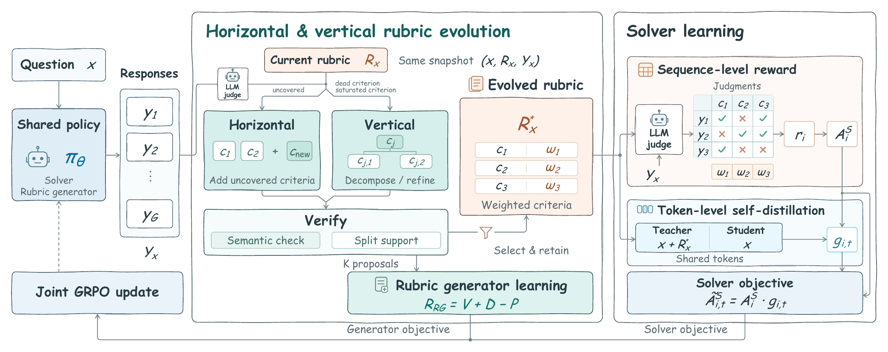
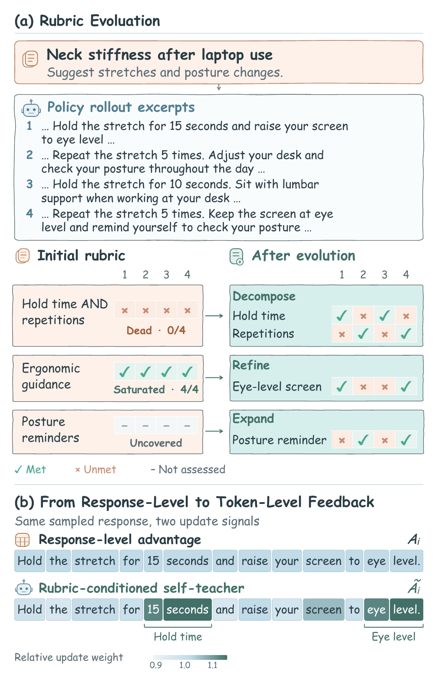

# LiveRubric

### Rubrics That Keep Teaching: Joint Policy Learning and Rubric Evolution for Open-Ended Reinforcement Learning

LiveRubric jointly trains a shared policy to solve open-ended tasks and evolve its evaluation rubrics. Horizontal expansion adds missing requirements; vertical evolution decomposes dead criteria and refines saturated ones. The evolved rubric supplies response-level rewards and guides token-level learning through a rubric-conditioned self-teacher.



<details>
<summary>Example: rubric evolution and token-level feedback</summary>

<p align="center"></p>

</details>

## Setup

The training pipeline uses **Ray + FSDP + vLLM** on Linux with CUDA. The supplied configuration targets **Qwen3-4B-Instruct-2507 on four GPUs**. Use Python 3.10+ and a local Hugging Face model directory.

```bash
python -m venv .venv
source .venv/bin/activate
pip install -r requirements.txt
pip install 'flash-attn>=2.4.3' --no-build-isolation
pip install -e '.[test]'
```

The runtime pins `vllm==0.11.0` and `transformers==4.57.3`. Configure the judge endpoint in [`configs/liverubric_4gpu.yaml`](configs/liverubric_4gpu.yaml) and supply its credential through `DEEPSEEK_API_KEY`. The paper configuration uses `deepseek-v4-flash-0731`.

Prepare the five HealthBench demonstrations locally following [`prompts/README.md`](prompts/README.md). Their contents are excluded from the public repository in line with the benchmark's leakage-prevention request; all prompt templates are included.

## Train and resume

Provide a JSONL file with `prompt` (text or chat messages) and `answer` (may be empty). With the default batch size, include at least 64 questions.

```json
{"prompt": [{"role": "user", "content": "Explain the requested topic."}], "answer": ""}
```

```bash
CUDA_VISIBLE_DEVICES=0,1,2,3 python train.py \
  --model /models/Qwen3-4B-Instruct-2507 \
  --train-file /datasets/train.jsonl \
  --output runs/healthbench

python train.py --output runs/healthbench --resume latest
```

Add `--dry-run` to the training command to inspect its configuration and execution plan. Add `--val-file` to enable periodic validation with rubric-annotated evaluation data.

The launcher first generates and caches initial rubrics with the frozen base model, then starts joint training. Checkpoints retain the actor, optimizer, scheduler, RNG, dataloader, independent teacher, and evolving rubric state. Resume checks data/configuration identity and checkpoint completeness. See [training details](docs/training.md) for data preparation, cache reuse, and checkpoint layout.

**Default settings:** two epochs; question batch 64; eight solver responses and eight proposals per applicable operation; solver/horizontal/vertical loss weights **1 : 0.125 : 0.125**; teacher coefficient **0.5**, refreshed every **10** steps.

## Code structure

```text
train.py                       Training entry
configs/                       Experiment configuration
prompts/                       Complete original prompts and demonstrations
rubric_generation/             Offline initial-rubric generation and caching
rewards/                       Criterion judge and reward aggregation
verl/trainer/                  Training loop, evolution, verification, proposal rewards
verl/workers/actor/             Joint optimization and token-level feedback
liverubric/                    Launch validation and checkpoint completion checks
tests/                         Reward, prompt, checkpoint, and runtime regression tests
```

Start with [`rubric_generator_training.py`](verl/trainer/rubric_generator_training.py) for evolution and [`rubric_joint_update.py`](verl/workers/actor/rubric_joint_update.py) for the shared-policy update. The extracted runtime preserves the original training path and 22 published prompt assets, with the demonstration data prepared locally. [Source notes](SOURCE_MAP.md) document the changes aligning it with the current paper.

## Checks

```bash
python -m unittest discover -s tests -p 'test_release.py' -v
python -m unittest discover -s tests/runtime -v
```

Local CPU checks cover proposal rewards, conserved family weights, prompt integrity, initialization, and checkpoint/teacher restoration. CUDA distributed training requires validation in the training environment. Upstream notices are retained in [THIRD_PARTY_NOTICES.md](THIRD_PARTY_NOTICES.md).
